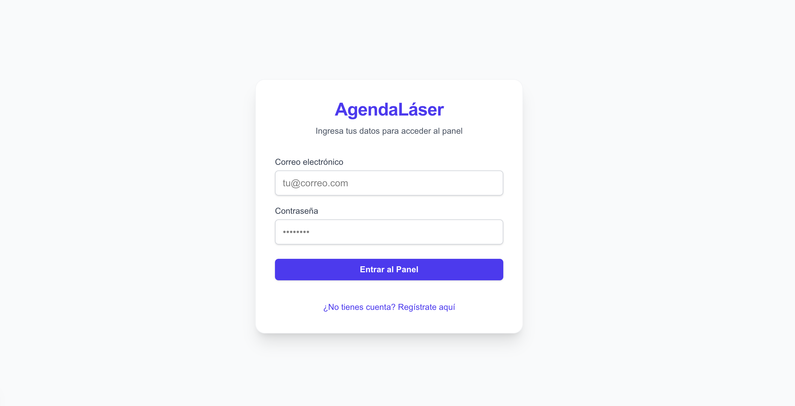
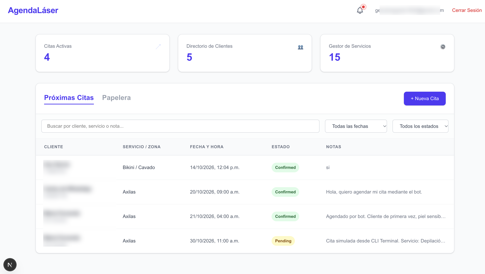
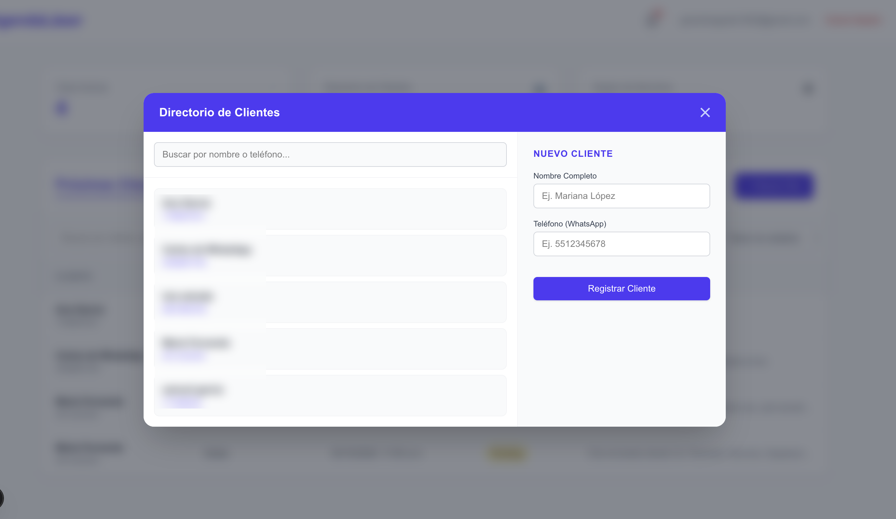
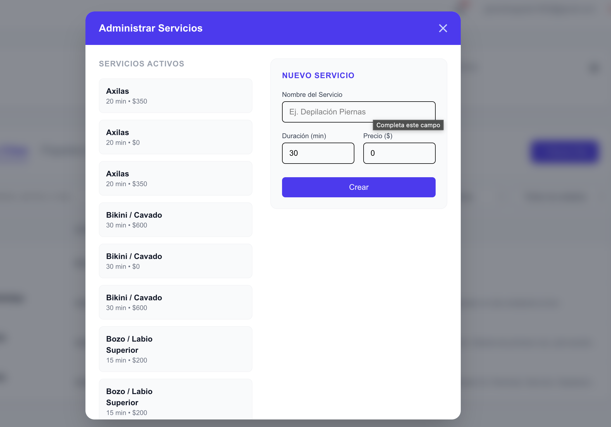

# AgendaLáser — CRM + Bot de WhatsApp para Clínica de Depilación Láser

> 🔒 Este repositorio es una **vitrina de portafolio**. El código fuente completo vive en un repositorio privado por tratarse de software en desarrollo para un cliente real. Aquí encontrarás arquitectura, decisiones técnicas y fragmentos seleccionados del código.

## 📋 Resumen

Sistema de agendamiento automatizado para una clínica de depilación láser. Combina un **panel de administración web (CRM)** para el personal del local con un **bot conversacional de WhatsApp** que permite a los clientes agendar su propia cita enviando un mensaje, sin que nadie del staff tenga que intervenir.

**Estado:** En desarrollo activo. Flujo completo (CRM + base de datos + endpoints + bot + simulador CLI) probado y funcional de punta a punta; pendiente el despliegue a producción.

## 🛠️ Stack técnico

| Capa | Tecnología |
|---|---|
| CRM (frontend + backend) | Next.js (App Router), serverless |
| Base de datos | Supabase (PostgreSQL) |
| Autenticación | Supabase Auth |
| Bot de WhatsApp | Node.js + Baileys (ES Modules) |
| Logging del bot | Pino |
| QR de vinculación | qrcode-terminal |
| Testing del flujo | Simulador CLI con `readline` nativo |

**¿Por qué Baileys en lugar de la API oficial de WhatsApp Business?** Decisión deliberada de costo: la API de Meta implica aprobación de negocio, costos por conversación y un proceso de verificación más largo. Baileys permite conectar un número de WhatsApp normal vía escaneo de QR (como WhatsApp Web), sin costo de mensajería — un trade-off razonable para un negocio pequeño en etapa de validación, aunque significa operar fuera del canal "oficial" soportado por Meta.

## 🏗️ Arquitectura

Dos módulos independientes que se comunican por HTTP REST:

```
 Cliente en WhatsApp
       │
       ▼
 Bot (Node.js + Baileys)  ──fetch──►  CRM (Next.js API /api/whatsapp)  ──►  Supabase (PostgreSQL)
 Escucha mensajes 24/7                Lógica de negocio y persistencia
```

El bot no toca la base de datos directamente: toda la lógica de negocio (deduplicación de clientes, validación de horarios, creación de citas) vive en el CRM, y el bot solo consume esa API. Esto mantiene una sola fuente de verdad y permite, por ejemplo, agregar más canales de entrada (web, otra línea telefónica) sin duplicar lógica.

## ✨ Funcionalidad

### Panel administrativo (CRM)
- Login con autenticación de Supabase, exclusivo para personal del local
- Dashboard con métricas: citas activas, clientes registrados, catálogo de servicios
- Gestión de citas: búsqueda, filtros por fecha/estado, papelera de reciclaje (sin borrado permanente accidental)
- Directorio de clientes con registro manual o automático (vía bot)
- Catálogo de servicios con duración y precio editables

### Bot de WhatsApp — máquina de estados conversacional
El bot guía al cliente paso a paso sin necesidad de comandos:

1. **Saludo** → el cliente escribe "hola" o "agendar"
2. **Nombre** → se solicita el nombre completo
3. **Servicio** → se muestra el catálogo numerado
4. **Fecha** → el cliente indica el día (`YYYY-MM-DD` o "mañana")
5. **Disponibilidad** → el bot consulta horarios ocupados en tiempo real y solo ofrece horas libres
6. **Confirmación** → se crea la cita en la base de datos y se confirma por chat

## 🔌 API

- `GET /api/whatsapp/horarios?date=YYYY-MM-DD` — devuelve las horas ya ocupadas ese día, para que el bot calcule disponibilidad
- `POST /api/whatsapp` — recibe los datos de la cita; si el teléfono ya existe en `clients`, reutiliza ese registro (deduplicación automática); si no, crea el cliente de forma transparente

## 🧩 Retos técnicos resueltos

- **Deduplicación de clientes por teléfono** — evitar que un mismo número genere registros duplicados al agendar varias veces
- **Zona horaria (UTC vs. hora local)** — una cita agendada a las 17:00 se mostraba a las 11:00 a.m. en el frontend; resuelto formateando la fecha en hora local directamente en la petición del bot, en vez de dejar que el navegador interprete un UTC crudo
- **Disponibilidad de base de datos en plan gratuito** — Supabase pausa instancias inactivas; se identificó y resolvió el error de conexión correspondiente

## 📸 Capturas

*(nombres y teléfonos de clientes de prueba difuminados por confidencialidad)*

**Login**


**Dashboard** — métricas y próximas citas, incluyendo citas agendadas automáticamente vía bot


**Directorio de clientes** — alta manual o automática desde WhatsApp


**Gestor de servicios** — catálogo con duración y precio


---

**Nota:** Datos de clientes reales, credenciales y lógica específica del negocio del cliente han sido omitidos de este repositorio por confidencialidad.
